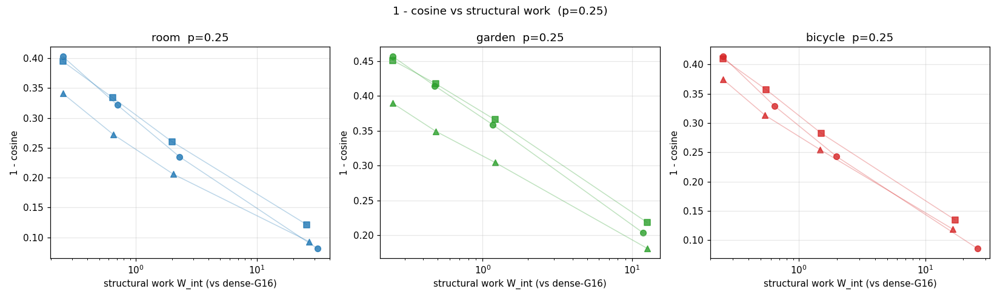
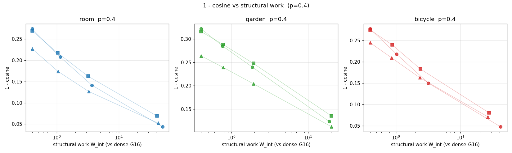
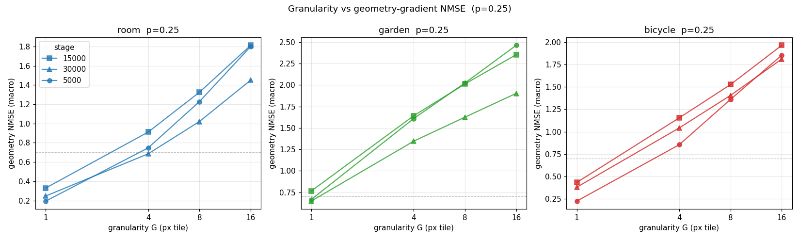
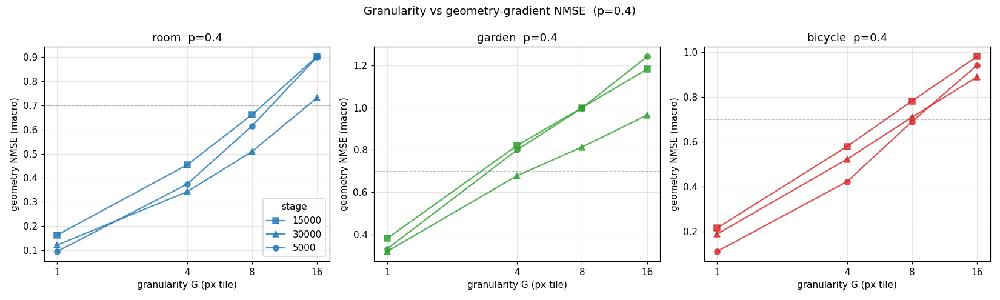
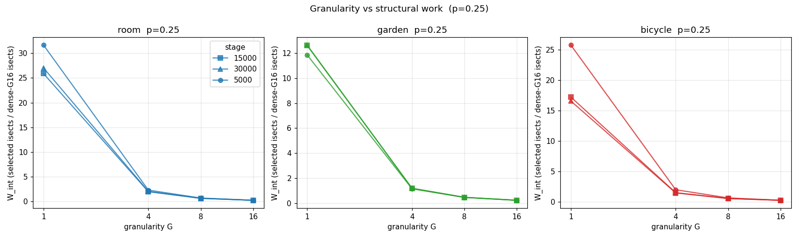
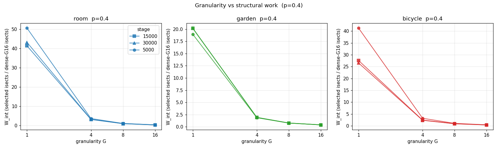
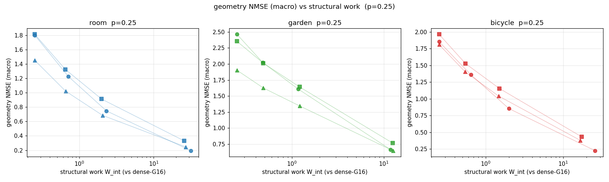
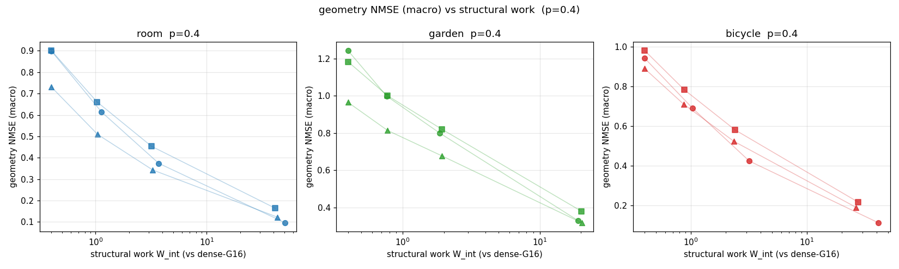

# WV-HIER-ORACLE0-MX — Work–Variance Co-Designed Hierarchical Sparse Training
## Execution: COMPLETE
Backend: gsplat 1.5.3 (torch 2.4.1+cu124, CUDA 12.4) on MX A100
States: 9 genuine frozen checkpoints (room/garden/bicycle × early/mid/late)
- bicycle: iter15000(N=3,903,754), iter30000(N=3,903,754), iter5000(N=1,934,146)
- garden: iter15000(N=3,006,472), iter30000(N=3,006,472), iter5000(N=2,780,622)
- room: iter15000(N=952,353), iter30000(N=952,353), iter5000(N=567,706)

Budgets: 0.25 / 0.40
Granularities: 16 / 8 / 4 / 1

Gradient reference: full-supervision L2 (per-pixel MSE), full image.
Sparse estimator: uniform-random tile subset (granularity G) with inverse-probability weighting (1/pi).

## Geometry-gradient NMSE (macro over means+quats+scales)

| scene | stage | p | G16 | G8 | G4 | G1 |
|---|---|---|---|---|---|---|
| bicycle | iter15000 | 0.25 | 1.965 | 1.526 | 1.154 | 0.433 |
| bicycle | iter15000 | 0.4 | 0.980 | 0.782 | 0.580 | 0.216 |
| bicycle | iter30000 | 0.25 | 1.812 | 1.405 | 1.042 | 0.379 |
| bicycle | iter30000 | 0.4 | 0.889 | 0.710 | 0.523 | 0.190 |
| bicycle | iter5000 | 0.25 | 1.854 | 1.361 | 0.854 | 0.224 |
| bicycle | iter5000 | 0.4 | 0.942 | 0.691 | 0.423 | 0.112 |
| garden | iter15000 | 0.25 | 2.353 | 2.013 | 1.642 | 0.764 |
| garden | iter15000 | 0.4 | 1.183 | 1.001 | 0.821 | 0.380 |
| garden | iter30000 | 0.25 | 1.903 | 1.626 | 1.345 | 0.647 |
| garden | iter30000 | 0.4 | 0.965 | 0.814 | 0.678 | 0.319 |
| garden | iter5000 | 0.25 | 2.463 | 2.024 | 1.609 | 0.665 |
| garden | iter5000 | 0.4 | 1.243 | 0.999 | 0.800 | 0.331 |
| room | iter15000 | 0.25 | 1.812 | 1.325 | 0.911 | 0.329 |
| room | iter15000 | 0.4 | 0.900 | 0.661 | 0.454 | 0.164 |
| room | iter30000 | 0.25 | 1.450 | 1.021 | 0.685 | 0.246 |
| room | iter30000 | 0.4 | 0.730 | 0.509 | 0.343 | 0.123 |
| room | iter5000 | 0.25 | 1.800 | 1.228 | 0.747 | 0.194 |
| room | iter5000 | 0.4 | 0.899 | 0.614 | 0.374 | 0.096 |

## Geometry-gradient cosine

| scene | stage | p | G16 | G8 | G4 | G1 |
|---|---|---|---|---|---|---|
| bicycle | iter15000 | 0.25 | 0.590 | 0.643 | 0.717 | 0.865 |
| bicycle | iter15000 | 0.4 | 0.725 | 0.760 | 0.817 | 0.919 |
| bicycle | iter30000 | 0.25 | 0.625 | 0.687 | 0.745 | 0.881 |
| bicycle | iter30000 | 0.4 | 0.755 | 0.790 | 0.837 | 0.929 |
| bicycle | iter5000 | 0.25 | 0.586 | 0.671 | 0.757 | 0.914 |
| bicycle | iter5000 | 0.4 | 0.722 | 0.782 | 0.850 | 0.952 |
| garden | iter15000 | 0.25 | 0.549 | 0.582 | 0.634 | 0.782 |
| garden | iter15000 | 0.4 | 0.684 | 0.712 | 0.752 | 0.865 |
| garden | iter30000 | 0.25 | 0.610 | 0.651 | 0.695 | 0.819 |
| garden | iter30000 | 0.4 | 0.736 | 0.761 | 0.796 | 0.888 |
| garden | iter5000 | 0.25 | 0.543 | 0.585 | 0.641 | 0.797 |
| garden | iter5000 | 0.4 | 0.678 | 0.715 | 0.760 | 0.877 |
| room | iter15000 | 0.25 | 0.605 | 0.666 | 0.740 | 0.879 |
| room | iter15000 | 0.4 | 0.731 | 0.782 | 0.837 | 0.931 |
| room | iter30000 | 0.25 | 0.659 | 0.728 | 0.794 | 0.907 |
| room | iter30000 | 0.4 | 0.773 | 0.826 | 0.873 | 0.948 |
| room | iter5000 | 0.25 | 0.597 | 0.678 | 0.765 | 0.919 |
| room | iter5000 | 0.4 | 0.726 | 0.792 | 0.859 | 0.956 |

## R_E = NMSE(G)/NMSE(G16) (geometry macro; <1 = improvement)

| scene | stage | p | R_E(G8) | R_E(G4) | R_E(G1) |
|---|---|---|---|---|---|
| bicycle | iter15000 | 0.25 | 0.777 | 0.587 | 0.220 |
| bicycle | iter15000 | 0.4 | 0.798 | 0.592 | 0.221 |
| bicycle | iter30000 | 0.25 | 0.776 | 0.575 | 0.209 |
| bicycle | iter30000 | 0.4 | 0.799 | 0.589 | 0.213 |
| bicycle | iter5000 | 0.25 | 0.734 | 0.461 | 0.121 |
| bicycle | iter5000 | 0.4 | 0.734 | 0.450 | 0.119 |
| garden | iter15000 | 0.25 | 0.855 | 0.698 | 0.325 |
| garden | iter15000 | 0.4 | 0.846 | 0.694 | 0.322 |
| garden | iter30000 | 0.25 | 0.854 | 0.707 | 0.340 |
| garden | iter30000 | 0.4 | 0.844 | 0.702 | 0.330 |
| garden | iter5000 | 0.25 | 0.822 | 0.653 | 0.270 |
| garden | iter5000 | 0.4 | 0.804 | 0.644 | 0.266 |
| room | iter15000 | 0.25 | 0.731 | 0.503 | 0.182 |
| room | iter15000 | 0.4 | 0.734 | 0.504 | 0.182 |
| room | iter30000 | 0.25 | 0.704 | 0.472 | 0.170 |
| room | iter30000 | 0.4 | 0.697 | 0.469 | 0.168 |
| room | iter5000 | 0.25 | 0.682 | 0.415 | 0.108 |
| room | iter5000 | 0.4 | 0.684 | 0.416 | 0.107 |

## Structural work (dense Gaussian-tile intersections, full image)

| scene | stage | vis Gaussians | G16 | G8 | G4 | G1 |
|---|---|---|---|---|---|---|
| bicycle | iter15000 | 1,166,547 | 4,016,382 | 8,824,149 | 24,153,385 | 276,905,019 |
| bicycle | iter30000 | 1,115,496 | 3,662,457 | 7,922,840 | 21,440,859 | 242,910,458 |
| bicycle | iter5000 | 450,265 | 2,413,832 | 6,209,018 | 19,206,646 | 248,988,458 |
| garden | iter15000 | 1,078,667 | 2,705,220 | 5,256,298 | 13,056,078 | 136,171,408 |
| garden | iter30000 | 1,074,596 | 2,682,079 | 5,210,094 | 12,954,997 | 135,416,681 |
| garden | iter5000 | 1,040,246 | 2,550,983 | 4,871,513 | 11,880,321 | 120,796,548 |
| room | iter15000 | 278,358 | 1,496,230 | 3,855,531 | 11,910,452 | 154,873,900 |
| room | iter30000 | 258,872 | 1,354,839 | 3,537,491 | 11,078,012 | 146,429,481 |
| room | iter5000 | 182,967 | 1,424,660 | 4,021,594 | 13,162,206 | 180,296,285 |

## Variance & bias (geometry macro, mean over masks)

| scene | stage | p | G | Var(geom) | Bias_relL2(geom) |
|---|---|---|---|---|---|
| bicycle | iter15000 | 0.25 | 16 | 2.448e+10 | 1.365 |
| bicycle | iter15000 | 0.25 | 8 | 1.780e+10 | 1.187 |
| bicycle | iter15000 | 0.25 | 4 | 1.366e+10 | 1.001 |
| bicycle | iter15000 | 0.25 | 1 | 8.936e+09 | 0.565 |
| bicycle | iter15000 | 0.4 | 16 | 1.645e+10 | 0.968 |
| bicycle | iter15000 | 0.4 | 8 | 1.247e+10 | 0.850 |
| bicycle | iter15000 | 0.4 | 4 | 1.072e+10 | 0.710 |
| bicycle | iter15000 | 0.4 | 1 | 8.315e+09 | 0.400 |
| bicycle | iter30000 | 0.25 | 16 | 7.255e+10 | 1.276 |
| bicycle | iter30000 | 0.25 | 8 | 5.570e+10 | 1.107 |
| bicycle | iter30000 | 0.25 | 4 | 4.456e+10 | 0.925 |
| bicycle | iter30000 | 0.25 | 1 | 2.979e+10 | 0.518 |
| bicycle | iter30000 | 0.4 | 16 | 5.060e+10 | 0.899 |
| bicycle | iter30000 | 0.4 | 8 | 3.956e+10 | 0.788 |
| bicycle | iter30000 | 0.4 | 4 | 3.520e+10 | 0.655 |
| bicycle | iter30000 | 0.4 | 1 | 2.745e+10 | 0.366 |
| bicycle | iter5000 | 0.25 | 16 | 1.991e+10 | 1.328 |
| bicycle | iter5000 | 0.25 | 8 | 1.492e+10 | 1.127 |
| bicycle | iter5000 | 0.25 | 4 | 1.082e+10 | 0.876 |
| bicycle | iter5000 | 0.25 | 1 | 7.738e+09 | 0.421 |
| bicycle | iter5000 | 0.4 | 16 | 1.401e+10 | 0.952 |
| bicycle | iter5000 | 0.4 | 8 | 1.063e+10 | 0.804 |
| bicycle | iter5000 | 0.4 | 4 | 9.044e+09 | 0.617 |
| bicycle | iter5000 | 0.4 | 1 | 7.452e+09 | 0.298 |
| garden | iter15000 | 0.25 | 16 | 7.448e+07 | 1.522 |
| garden | iter15000 | 0.25 | 8 | 6.597e+07 | 1.400 |
| garden | iter15000 | 0.25 | 4 | 5.590e+07 | 1.247 |
| garden | iter15000 | 0.25 | 1 | 3.557e+07 | 0.815 |
| garden | iter15000 | 0.4 | 16 | 4.764e+07 | 1.082 |
| garden | iter15000 | 0.4 | 8 | 4.260e+07 | 0.989 |
| garden | iter15000 | 0.4 | 4 | 3.746e+07 | 0.882 |
| garden | iter15000 | 0.4 | 1 | 2.729e+07 | 0.575 |
| garden | iter30000 | 0.25 | 16 | 1.551e+08 | 1.306 |
| garden | iter30000 | 0.25 | 8 | 1.412e+08 | 1.195 |
| garden | iter30000 | 0.25 | 4 | 1.174e+08 | 1.068 |
| garden | iter30000 | 0.25 | 1 | 7.438e+07 | 0.704 |
| garden | iter30000 | 0.4 | 16 | 1.028e+08 | 0.937 |
| garden | iter30000 | 0.4 | 8 | 9.039e+07 | 0.850 |
| garden | iter30000 | 0.4 | 4 | 7.961e+07 | 0.758 |
| garden | iter30000 | 0.4 | 1 | 5.691e+07 | 0.495 |
| garden | iter5000 | 0.25 | 16 | 8.605e+07 | 1.541 |
| garden | iter5000 | 0.25 | 8 | 7.226e+07 | 1.395 |
| garden | iter5000 | 0.25 | 4 | 5.899e+07 | 1.222 |
| garden | iter5000 | 0.25 | 1 | 3.731e+07 | 0.767 |
| garden | iter5000 | 0.4 | 16 | 5.498e+07 | 1.100 |
| garden | iter5000 | 0.4 | 8 | 4.723e+07 | 0.984 |
| garden | iter5000 | 0.4 | 4 | 4.015e+07 | 0.864 |
| garden | iter5000 | 0.4 | 1 | 2.962e+07 | 0.541 |
| room | iter15000 | 0.25 | 16 | 1.470e+07 | 1.325 |
| room | iter15000 | 0.25 | 8 | 1.174e+07 | 1.128 |
| room | iter15000 | 0.25 | 4 | 9.430e+06 | 0.924 |
| room | iter15000 | 0.25 | 1 | 6.208e+06 | 0.531 |
| room | iter15000 | 0.4 | 16 | 9.579e+06 | 0.936 |
| room | iter15000 | 0.4 | 8 | 8.291e+06 | 0.797 |
| room | iter15000 | 0.4 | 4 | 7.017e+06 | 0.652 |
| room | iter15000 | 0.4 | 1 | 5.435e+06 | 0.375 |
| room | iter30000 | 0.25 | 16 | 2.486e+07 | 1.157 |
| room | iter30000 | 0.25 | 8 | 2.006e+07 | 0.957 |
| room | iter30000 | 0.25 | 4 | 1.579e+07 | 0.765 |
| room | iter30000 | 0.25 | 1 | 1.080e+07 | 0.433 |
| room | iter30000 | 0.4 | 16 | 1.662e+07 | 0.823 |
| room | iter30000 | 0.4 | 8 | 1.431e+07 | 0.676 |
| room | iter30000 | 0.4 | 4 | 1.199e+07 | 0.542 |
| room | iter30000 | 0.4 | 1 | 9.620e+06 | 0.305 |
| room | iter5000 | 0.25 | 16 | 2.978e+07 | 1.324 |
| room | iter5000 | 0.25 | 8 | 2.266e+07 | 1.088 |
| room | iter5000 | 0.25 | 4 | 1.761e+07 | 0.844 |
| room | iter5000 | 0.25 | 1 | 1.189e+07 | 0.421 |
| room | iter5000 | 0.4 | 16 | 1.987e+07 | 0.938 |
| room | iter5000 | 0.4 | 8 | 1.646e+07 | 0.771 |
| room | iter5000 | 0.4 | 4 | 1.401e+07 | 0.598 |
| room | iter5000 | 0.4 | 1 | 1.103e+07 | 0.297 |

## Figures

## Verdict

**GO_CODEX_HIER_EXECUTION**

Gate A (>=30% NMSE reduction, >=2 scenes, >=2 stages): {"8": false, "4": true}
Gate B (cosine improvement): {"8": true, "4": true}
Gate C (W<=0.70): satisfied (W_int=p at both budgets)
Gate D (high-load scene): {"8": false, "4": true}
